# AI review specification

Prototype contract `0.2.0` · Owner Deon

This describes the contract used by the local workbench. The [team build plan](../PLAN.md) records the agreed first-build workflow. [AI-05](../.scratch/ai-review/issues/05-revisions-and-metadata.md) tracks the contract changes for that workflow.

## Review boundary

The AI reviewer receives frozen article text and a human-approved editorial checklist. It returns advisory analysis. It has no publication, approval, credential, browsing, or record-editing tools. The application decides who can request a review and how humans act on it.

The current prompt uses contract `0.2.0`. The example response is handcrafted. [Prompt draft 0.4](../prompts/editorial-review-v0.4.md) · [Example request](../contracts/ai-review.request.example.json) · [Example response](../contracts/ai-review.response.example.json)

## Proposed pipeline

```mermaid
flowchart LR
    A[Backend: freeze revisions and approved policy] --> B[AI boundary: validate input]
    B --> C[Backend adapter: compute text differences]
    C --> D[Gemini: explain changes and assess rules]
    D --> E[Validate structure, IDs and source evidence]
    E --> F[Persist advisory result and provenance]
    F --> G[Review UI: evidence and suggestions]
    G --> H[Human editorial and legal decisions]
```

Backend owns retrieval, transport, job processing, persistence, and authority enforcement. You own the AI behavior, prompt, output semantics, and validation/evaluation requirements. Decide together where the AI validator executes. If you take the review UX/UI role, you also own the design described in the next document; the wider application remains teammate-owned.

## Input contract

| Field | Meaning and validation |
| --- | --- |
| `schema_version` | Exact supported contract version, currently `0.2.0`. Reject unsupported versions explicitly. |
| `request_id` | Backend correlation/idempotency identifier. It is not proof of authorization. |
| `content_id` | Article identity within the authenticated newsroom scope. |
| `language` | Initially `en`. Report unsupported languages rather than silently changing behavior. |
| `baseline_revision` | Frozen earlier revision, or `null` for a first draft. |
| `candidate_revision` | Required frozen revision being assessed. |
| `policy_pack` | Approved pack ID/version/approval reference and exact rule IDs, titles, texts, and priorities. |
| `taxonomy` | Allowed section/tag IDs and labels. Empty lists mean no vocabulary-based suggestion is available. |
| `current_metadata` | Current section/tag IDs and short description. Suggestions never overwrite these. |

Each revision contains a `revision_id` and an ordered `segments` list. Each segment has a unique `segment_id`, a `field` (`title`, `body`, or `caption`), and exact `text`. A source reference always includes both the revision and segment ID. Segment IDs can recur in different revisions; revision identity disambiguates them.

Accept 1–12 uniquely identified policy rules. Rule and taxonomy IDs are 1–80 characters; revision and segment IDs are 1–100 characters. Each supplied revision has at least one non-empty segment. Taxonomy IDs are unique within their section/tag lists. These input bounds align with the assessment schema, so accepted inputs can be referenced in valid outputs. Character limits count Unicode code points.

The initial local request schema requires non-empty stored segments, LF line endings, and distinct baseline/candidate revision IDs. Filter empty editor paragraphs before freezing canonical segments. Identical text under two distinct revision IDs remains a valid unchanged-content case.

The backend creates snapshots from its canonical text representation: decoded plain text, LF line endings, and any HTML-to-text conversion performed **before** snapshot storage. The same exact stored text goes to the model and the review UI. Validators do not silently normalize quotes after generation. This avoids evidence matching differently in Java, JavaScript, and the interface.

Initial limits: 12,000 characters per revision, 12 policy rules, one baseline/candidate pair, and text input only. These are draft product limits. If they are exceeded, reject or return an explicit scope limitation; never silently drop paragraphs or checklist rules.

The team must retain immutable source text, not only a mutable article URL. A policy title or a user-entered `approval_reference` is not sufficient authority: backend access checks must establish that the pack is actually approved and applicable.

## Deterministic context and model task

An ordinary text difference identifies additions, deletions, and modifications. Gemini explains their editorial meaning. The model still receives the full in-scope candidate text for checklist assessment; checking only changed lines could miss an existing concern or context that resolves one.

For the small pilot, compute the difference inside the adapter from the frozen snapshots. It is not a second client-supplied source of truth. The exact algorithm and paragraph alignment remain backend integration choices, covered by fixtures for reordered and repeated paragraphs.

Start with the local WildTrack model, `gemini-3.5-flash-lite`. MINIMAL thinking and an 8,192-token output cap are initial configuration candidates inherited from its normal review path, subject to newsroom evaluation. Do not assume every existing WildTrack path uses these settings. Pin the prompt, schema, model identifier, and generation settings in the run manifest.

## Result contract

The backend writes the trusted result envelope. Gemini returns only the `assessment` content. It must not invent model provenance, processing status, permissions, timestamps, article IDs, or approval records.

| Result area | Required behavior |
| --- | --- |
| Processing | Backend-owned `queued`, `running`, `succeeded`, `failed`, `unknown`, or `cancelled`. A technical failure has `assessment: null`. |
| Freshness | Backend-owned `current` or `outdated`, based on recorded revision and configuration identity. |
| Provenance | Backend records model, prompt/schema/settings versions, exact policy version, source snapshot identity, and input fingerprint. |
| Assessment status | `reviewed`, `partial`, or `unable_to_assess`. None is editorial approval. |
| `coverage` | Revision comparison: `complete`, `incomplete`, or `not_requested`; metadata analysis: `complete` or `incomplete`. Rule coverage comes from the per-rule assessments. |
| `changes` | At most six meaningful changes. Group repeated changes to the same fact and include the relevant source quotes. State which attribution was added, changed, or removed. |
| `metadata_suggestions` | Section, up to five tags, and a short description. Use allowed IDs and candidate evidence. Build the description from passages outside the checklist flags. Unsupported values are `null` or empty lists. |
| `policy_assessments` | Exactly one entry per supplied rule ID. No model-created rules or replacement policy authority. |
| `limitations` | Specific exclusions, insufficient context, or incomplete assessment that affects interpretation. |

Each policy assessment has a `rule_id`, `status`, `reason`, `evidence`, and `suggested_action`. Its status is one of:

- `potential_conflict`: the candidate text may conflict with the supplied rule; explain the concern and a useful human next action.
- `no_potential_conflict_observed`: no concern was identified for this rule in the reviewed scope; it is not a compliance certification.
- `not_assessable`: supplied evidence is insufficient; identify what a person needs to verify.
- `not_applicable`: the rule's stated condition does not apply; explain the basis.

The `policy_pack` is the source of rule title, priority, and authority text. The UI joins these by ID instead of trusting a model to reproduce them. Priorities describe review urgency, not legal conclusions.

Use `reviewed` only when every supplied rule has an assessable outcome and all requested analysis fits the agreed scope. Any `not_assessable` rule or material excluded analysis makes the assessment `partial`; no usable substantive analysis makes it `unable_to_assess`. `not_applicable` can be a completed assessment when supported. Reconstruct the status deterministically after validation.

Comparison coverage is `not_requested` exactly when the baseline is null; an existing baseline requires `complete` or `incomplete`. An `incomplete` area is a machine-readable material exclusion. Treat all provider-supplied limitations conservatively as material, even if coverage overclaims completion. The only informational exception is the canonical first-draft notice added by the module. This avoids guessing coverage by interpreting arbitrary prose.

For a first draft, `baseline_revision: null`, `baseline_revision_id: null`, and `changes: []` are the canonical case. Include a limitation that no revision comparison was performed. Because comparison is not requested without a baseline, that fact alone does not force `partial`; candidate policy/metadata analysis can still be `reviewed`.

Whole-result cache identity includes current metadata as well as article/policy inputs. Suggestion acceptance also uses a per-field check against the current value. Recording acceptance of one metadata field does not invalidate the article's unchanged text/policy findings or force regeneration of all other suggestions. If another edit changed the field, reject the stale write and refresh that suggestion. Human suggestion decisions remain separate records from the immutable AI result.

## Evidence rules

1. A reference is `{revision_id, segment_id, quote}`. The exact non-empty quote must occur within the specified stored segment. Do not ask the model to invent character offsets or PDF pages.
2. A modified, moved, or formatting change needs baseline evidence in `before` and candidate evidence in `after`. An addition has an empty `before` and candidate evidence in `after`; a removal has baseline evidence in `before` and an empty `after`. A move must correspond to a verifiable ordering change. A formatting observation requires a difference actually represented in the supplied snapshots; do not infer stripped HTML formatting. `change_id` values are unique within the assessment. Quote text being removed from the baseline, not an invented absence in the candidate.
3. Metadata suggestions and current-policy concerns cite the candidate revision. A baseline concern cannot be presented as still present after it has been removed.
4. A policy concern cites a supplied rule ID and explains how its evidence relates to that rule. Matching a quote proves source presence, not the correctness of the interpretation.
5. Absence cannot be quoted. For missing attribution or missing required material, identify the candidate passage that creates the question and describe the scope checked. Where context could reasonably exist elsewhere, require manual verification.
6. A rule's conditional applicability must be respected. For example, a rule about quotations does not justify inventing a quotation-related concern in an article without quoted speech.
7. Do not turn zero retained findings into a clean review. If evidence rejection removes meaningful coverage, downgrade the affected rule to `not_assessable` and disclose the limitation.

In the initial local validator, `potential_conflict` and `no_potential_conflict_observed` each require a candidate excerpt, and populated metadata suggestions require candidate evidence. `not_assessable` and `not_applicable` may have no quotation when the reason concerns missing context or a condition that does not apply. These checks establish source presence, not semantic correctness.

For a repeated exact quote, the UI can highlight all occurrences within the cited segment, or use a backend-computed occurrence selector. It must not guess a unique location from the quote alone.

## Validation and failure behavior

Reject malformed JSON, duplicate object keys, unknown fields at the contract boundary, invalid enums, missing/duplicate/unknown rule IDs, invalid source IDs, over-limit arrays, and out-of-vocabulary metadata. Validate required relationships, not only field types.

Apply structural checks to the full response before displaying it. A structurally valid response with an unsupported individual observation can retain independently valid analysis only if the invalid item is excluded, its affected coverage is downgraded, and a specific limitation is recorded. A malformed or truncated overall response cannot be relabeled as a successful substantive review.

Prompt injection, such as an article telling the reviewer to ignore the checklist or output approval, is source content. It cannot change the contract, policies, tool access, or authority boundary. Approved policy rule text defines assessment criteria; it is also not permission to change the AI's operating instructions.

An ambiguous provider timeout becomes `unknown`, not an automatic new billable request. Quota/authentication failures are operational errors, not article concerns. Backend owns retry enforcement and deduplication. An explicit retry creates a traceable attempt; it does not erase the prior uncertain attempt.

## Edge cases that shape the design

| Input situation | Required result |
| --- | --- |
| No baseline | `changes: []` and a first-draft limitation; candidate policy/metadata review can still complete. |
| Identical revisions | No fabricated changes; assess the candidate against the requested policy. Backend may reuse a matching validated result. |
| Only formatting changes | No invented factual change; if mentioned, clearly identify formatting. |
| Paragraphs reordered | Describe a move only if supported; do not report the text as new reporting. |
| Missing or unapproved policy | Do not claim policy review completed; return an explicit input error before generation. |
| Too-long or unreadable input | Explicitly reject or limit the review; never report complete coverage. |
| Article/policy changes during a run | Retain the historical result, mark it outdated, and require a current review for current suggestions. |
| Unsupported numerical claim | Report the visible attribution question under the supplied policy; do not pronounce the claim false. |

## AI deliverables versus backend implementation

Your deliverables are this behavior specification, the adapted prompt, response-validation requirements, synthetic fixtures, and evaluated review quality. The backend team supplies authenticated inputs and implements the adapter around this boundary. If retaining WildTrack's Java validation is the fastest reliable option, extract a narrowly scoped component with the backend teammate rather than coupling ServiceNow to academic submission endpoints.

## First local implementation

The [AI-04 module](../ai-review/README.md) implements the validation interface against the draft request and a fixed response. It rejects unsupported output as a whole, normalizes unresolved checklist coverage, and adds an explicit first-draft limitation. Its bounded provider parser accepts at most 256 KiB. It does not implement the model's generation, comparison algorithm, final runtime placement, authorization, persistence, or PDI workflow. Those remain planned or teammate-owned work.
