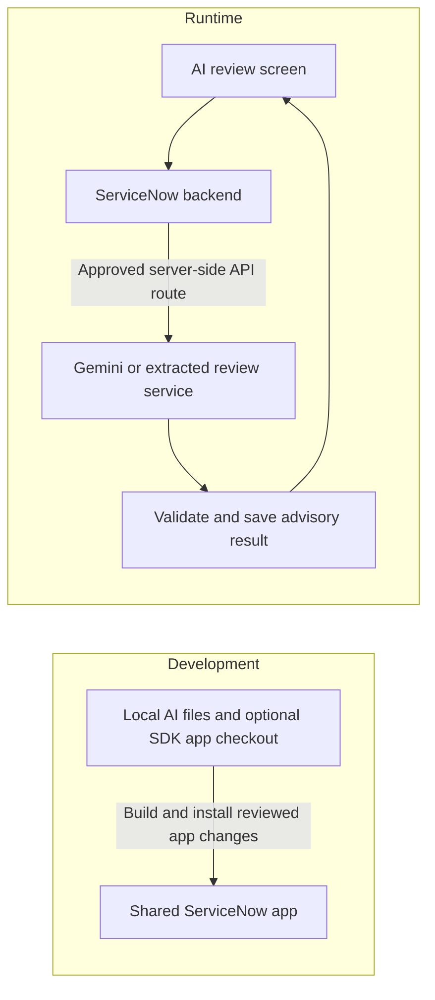

# Developing AI review here and connecting it to the PDI

**Planning guide · 11 November 2026 · no SDK setup or deployment performed**

## The direct answer

The documents and first local AI validation module live in this project folder. We have not yet created ServiceNow application source, a configured SDK connection, or a ServiceNow endpoint. Your shared **PDI** — Personal Developer Instance — is [dev309702.service-now.com](https://dev309702.service-now.com).

Develop the AI behavior locally, test it with the agreed request/response contract, then connect that boundary to the team's ServiceNow backend. You do not need to build the entire app to work on AI review.

## Two different connections

The SDK development connection moves application changes to an instance. The runtime integration requests AI analysis when someone uses the app. One does not configure the other. This distinction follows from the separate [SDK](https://servicenow.github.io/sdk/getting-started) and [outbound REST](https://www.servicenow.com/docs/r/api-reference/server-api-reference/c_RESTMessageV2API.html) interfaces.

The ServiceNow developer login, Gemini API credential, application scope, and optional gateway credential are separate things. The hostname alone identifies none of the application's scope or provider settings. Do not put credentials in the planning files.

## What to develop locally

The AI module has one small interface: receive a frozen baseline/candidate revision and approved checklist, then return a validated advisory assessment. The [local foundation](../ai-review/README.md) now implements that validation path with a fixed response. Actual generation, comparison context, live provider adaptation, and model evaluation remain later steps.

Use WildTrack as source material for useful behavior and tests. Keep that project unchanged while creating a newsroom-specific module. Its academic submission endpoints and Java runtime are not automatically executable ServiceNow application components.

The `ai-review/` folder now contains a Node JavaScript harness and its tests. Choose the deployed runtime with the backend teammate after the reuse spike. If direct ServiceNow execution is selected, distinguish portable review logic from Node-specific or SDK-only APIs; validate compatibility on the actual instance. If Java logic is retained, plan its external runtime and deployment explicitly.

## How local editing reaches ServiceNow

There are two supported development routes. ServiceNow Studio edits the application on the instance. The SDK lets developers work with application source locally and install a built package on an instance. [Studio learning material](https://developer.servicenow.com/print_page.do?category=learning-plans&identifier=new_to_servicenow&module=learning+plan&release=yokohama), [SDK development guide](https://servicenow.github.io/sdk/guides/developing-apps-guide)

The proposed local route is:

1. Agree the **new shared team app's** name/scope and who coordinates installs. The user confirmed the teammate has not started it. Record its `sys_app` ID after creation; if the teammate creates it before SDK setup, use that same app.
2. Confirm the actual instance and selected SDK versions are compatible.
3. Create an SDK-managed local authentication alias for this PDI using the interactive login procedure.
4. Scaffold the agreed new app in the SDK subfolder, or import by app ID if the teammate created it first. Preserve identifiers and teammate changes.
5. Edit only the owned AI integration files or coordinate changes with their owner.
6. Build locally, review the package, reconcile current instance changes, then install the agreed change on the PDI.
7. Check the resulting behavior and records on the actual PDI.

These are future steps. Saving a local prompt does not automatically update ServiceNow. SDK installation is an instance write. Studio and local edits need one agreed synchronization practice. The exact version-cautioned commands are kept in [the connection research note](09-servicenow-connection-research.md), rather than duplicated here. [SDK CLI](https://servicenow.github.io/sdk/cli)

If the team is already developing through Studio/source control, use its established route until a coordinated SDK workflow is agreed. Do not create a second unrelated ServiceNow app just to attach your AI work.

## How a review runs on the PDI

Proposed application behavior:

1. An authorized user requests review of a specific article revision.
2. The backend loads frozen source text, the baseline, the approved policy version, and metadata vocabulary.
3. The backend creates a run record and calls the agreed AI boundary server-side.
4. The AI produces structured assessment content.
5. The validator checks structure, known IDs, exact source excerpts, coverage, and authority limits.
6. The backend records provenance/currentness and stores the result.
7. The review screen displays findings and suggestions; humans decide what to accept or escalate.

ServiceNow's RESTMessageV2 can support the outbound HTTP part. A visual Workflow Studio REST step is a different capability with Integration Hub prerequisites. The backend owner must verify the route available on this instance. [RESTMessageV2](https://www.servicenow.com/docs/r/api-reference/server-api-reference/c_RESTMessageV2API.html), [REST step](https://www.servicenow.com/docs/r/build-workflows/workflow-studio/rest-request-action-designer.html)

An inbound Scripted REST API is only needed if the agreed caller requires one. The team can also use its existing internal server action. A hypothetical custom API name is not an endpoint that exists today. [Scripted REST APIs](https://www.servicenow.com/docs/r/api-reference/rest-api-explorer/c_CustomWebServices.html)

## Choosing the runtime route

| Route | Why consider it | What must be proved |
| --- | --- | --- |
| PDI backend → Gemini → PDI validator | Fewer hosted application components and one system of record | Protected provider credential handling, compatible validation, provider request mapping, and acceptable execution behavior. |
| PDI backend → extracted review service → Gemini | Preserve valuable Java review/validation code from WildTrack | A narrowly scoped service, authenticated reachable HTTPS endpoint, deployment ownership, and retained source/evidence identity. |

The direct route is the current first-spike recommendation, not a finalized architecture. If the extraction trial shows that it discards too much useful validation or creates an awkward platform port, change the plan to the service route before integrating. Either route keeps the same user-facing review contract.

Google documents a normal content-generation API, so the runtime design does not need MCP merely to request model output. Provider-specific wire fields belong in the adapter; the UI should consume the project's assessment contract. [Gemini content-generation API](https://aistudio.google.com/api-reference/generate-content)

## Why the PDI cannot simply call your local WildTrack URL

`localhost` refers to the machine making the request. A cloud ServiceNow server calling `localhost:8080` is not calling your laptop. For an external review service, provide an authenticated endpoint reachable from the PDI; a hosted HTTPS service is the proposed demo option. Private-network routing is a separate setup. [RFC 6761](https://www.rfc-editor.org/rfc/rfc6761#section-6.3)

You can test local AI behavior without exposing your laptop. Deploying a review service, creating a tunnel, or installing a MID Server is not part of this documentation pass.

## Shared-instance handoff

You own AI behavior and may own its review interface. Backend teammates own the application records, provider transport/secrets, queue, deployment, and authenticated actions. Work together at the contract and validation boundary. Frontend teammates own the rest of the application experience.

Do not confuse deploying configuration with transferring article/review data. The team needs a separate synthetic demo-data and recovery plan. Current instance release, app ID/scope, installed features, provider access, and transport choice remain documented checkpoints. Start with [PLAN.md](../PLAN.md) for the editable order.
