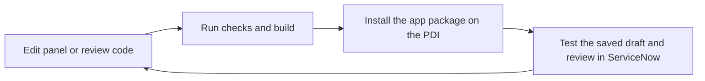

# Developing and pushing Suiko AI

Team Backyardigans · 12 November 2026

## Development workflow

Write the app locally in [servicenow-app](../servicenow-app/README.md). Build it with the pinned ServiceNow SDK and install the resulting package onto the team's PDI. ServiceNow documents this as its local build and install loop. The SDK also supports pulling Studio changes back into the source. [SDK development guide](https://servicenow.github.io/sdk/guides/developing-apps-guide)



From this workspace, the single command for that loop is

```powershell
npm --prefix servicenow-app run push:pdi
```

## Changes made in Studio

For a form, list view, or flow, use the visual editor in the existing **Suiko AI** scope. Save and test the change on the PDI. Then commit or stash any unrelated local edits before bringing in the instance changes.

```sh
cd servicenow-app
npm exec -- now-sdk transform --auth suiko-pdi
git status --short
git diff
```

Review the downloaded changes and keep the ones for your ticket. The SDK converts supported app files to source and can keep other metadata in XML. Confirm the files appear in the build, including any new record identities in `src/fluent/generated/keys.ts`. Build from your branch and check the Studio change after a coordinated test install. [SDK development guide](https://servicenow.github.io/sdk/guides/developing-apps-guide#pulling-changes-made-directly-on-an-instance)

## GitHub checks and deployment

The [workflow](../.github/workflows/suiko-pdi.yml) installs pinned dependencies, runs the tests, and builds with `--frozenKeys` on pull requests and relevant pushes to `main`. The build checks that existing ServiceNow records keep their identities. A manual run on `main` can install the checked package on the PDI and then check the page and API. Deployments from GitHub run one at a time.

To edit the workflow, branch from an up-to-date `main`, change the YAML file, and push your branch.

```sh
git switch main
git pull --ff-only
git switch -c ci/update-pdi-workflow
# Edit .github/workflows/suiko-pdi.yml
git add .github/workflows/suiko-pdi.yml
git commit -m "Update PDI workflow"
git push -u origin ci/update-pdi-workflow
```

Open a pull request and check the build on GitHub.

The SDK documents environment-variable authentication for installs on a shared development or test instance. The workflow uses that mechanism for the assigned PDI. [SDK CI integration](https://servicenow.github.io/sdk/config/ci-integration)

When the team is ready to deploy from GitHub, the repository owner adds these Actions secrets in **Settings → Secrets and variables → Actions**.

| Secret | What to enter |
| --- | --- |
| `SERVICENOW_USERNAME` | Account used for PDI deployments |
| `SERVICENOW_PASSWORD` | That account's password |

Then open **Actions → Suiko AI checks and PDI deployment → Run workflow**, choose **main**, and run it. The workflow targets `https://dev309702.service-now.com`. The Gemini key is already configured on the PDI and lives there separately from the repository.

## Keep app identity and user data

Keep `now.config.json` and `src/fluent/generated/keys.ts` with the app source. They identify the app and its configuration records during later installs. Each locally generated record ID stays stable so a new build updates that record. [SDK record IDs](https://servicenow.github.io/sdk/fluent/now-id-guide)

Provider setup adds two starter rules only when the rules table is empty. Disabled rules count as existing rules. Rules are runtime records, so app installs do not reapply their starting wording or version. Each review saves its own rule snapshot. Drafts, reviews, metadata choices, and the encrypted provider key are also runtime data.

The initial development build included the two starter rules in the app package. The 12 November migration removed those two definitions and their keys together so the existing rows stay in the instance as editor-managed data. Keep every other generated key. Do not recreate the starter-rule definitions in Fluent.

## Test the review

1. Open [Suiko AI](https://dev309702.service-now.com/x_2236136_suiko_ai_review.do).
2. Choose **Load a sample**, then **River draft 1**. Save it and click **Review this version**.
3. Read the overview and findings. Expand a passage and inspect the rule that prompted it.
4. Load **River draft 2**, save it under the same story, and review it. Check the grouped schedule change and the outside-clip permission question.
5. Edit a suggested tag or description and save your choice.
6. Open **Editorial rules**, edit a shared rule, and run a new review. Open the earlier run to inspect its original rule wording.

## Remaining team setup

GitHub deployment credentials still need to be configured before the first manual deploy. Use the local command when testing a coordinated update to the PDI. The Inbox, legal approval, and decision history are in [Team tasks](../TEAM-TASKS.md).

The 12 November check passed all 23 review tests and a frozen-key SDK build. Both river drafts completed on 3.5, and an unrelated library first draft completed on the recorded 3.1 fallback. The library review caught an unsupported attendance estimate and left it out of the description, but added descriptive wording such as "guided" beyond the supplied text. Broader AI quality checks, ordinary-account authorization tests, and simulated concurrent-user failures remain in the plan.

The dependency audit reported no runtime dependency findings and 21 findings in SDK/build dependencies. The project uses the verified SDK 4.14.0 without forcing incompatible audit fixes.
