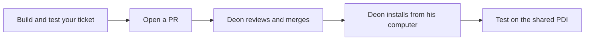

# Developing and pushing Suiko AI

Team Backyardigans · Updated 13 November 2026

Deon owns all custom screens. Teammates build ServiceNow records, actions and permissions. The current [task steps](../TEAM-TASKS.md) and [screen/API contract](25-workspace-service-contract.md) supersede the earlier native-Inbox/legal-form screen split. GitHub also runs the newsroom component suite with `npm --prefix servicenow-app run test:ui`.

## Development workflow

Work locally in [servicenow-app](../servicenow-app/README.md). Run the tests and build with the pinned ServiceNow SDK, then open a PR from your fork. After Deon reviews and merges it, he installs the build from his local clone. Test the change in the shared ServiceNow app after he confirms the install. [GitHub team workflow](14-github-team-workflow.md)



## Changes made in Studio

For a form, list view, or flow, coordinate with Deon and use the visual editor in the existing **Suiko AI** scope. Save and test the change on the PDI. Send Deon the ticket number and the names of the app files you edited so he can pull them down with the SDK.

Review the exported changes together and include the ones for your ticket in your PR. The SDK converts supported app files to source and can keep other metadata in XML. Include any new record identities in `src/fluent/generated/keys.ts`. This lets the next build reproduce your Studio changes. [SDK development guide](https://servicenow.github.io/sdk/guides/developing-apps-guide#pulling-changes-made-directly-on-an-instance)

## GitHub checks

The [workflow](../.github/workflows/suiko-pdi.yml) installs pinned dependencies, runs the tests, and builds with `--frozenKeys` on relevant PRs and pushes to `main`. The build checks that ServiceNow records keep their identities and uploads the package under **Actions**. Deon uses his local ServiceNow login for the install and checks the app page and API afterwards.

To edit the workflow, branch from an up-to-date `main`, change the YAML file, and push your branch.

```sh
git switch main
git pull --ff-only
git switch -c ci/update-app-checks
# Edit .github/workflows/suiko-pdi.yml
git add .github/workflows/suiko-pdi.yml
git commit -m "Update app checks"
git push -u origin ci/update-app-checks
```

Open a pull request and check the build on GitHub.

## Keep app identity and user data

Keep `now.config.json` and `src/fluent/generated/keys.ts` with the app source. They identify the app and its configuration records during later installs. Each locally generated record ID stays stable so a new build updates that record. [SDK record IDs](https://servicenow.github.io/sdk/fluent/now-id-guide)

Provider setup adds two starter rules only when the rules table is empty. Disabled rules count as existing rules. Rules are runtime records, so app installs do not reapply their starting wording or version. Each review saves its own rule snapshot. Drafts, reviews, metadata choices, and the encrypted provider key are also runtime data.

The initial development build included the two starter rules in the app package. The 12 November migration removed those two definitions and their keys together so the existing rows stay in the instance as editor-managed data. Keep every other generated key. Do not recreate the starter-rule definitions in Fluent.

## Test the review

1. Open [Suiko AI](https://dev309702.service-now.com/x_2236136_suiko_ai_review.do).
2. Choose **Try a sample story**, then **River script**. Save it and click **Review this version**.
3. Read the overview and findings. Expand a passage and inspect the rule that prompted it.
4. Choose **Try a sample → River script revision**, save it under the same story, and review it. Check the grouped schedule change and outside-clip permission question.
5. Edit a suggested tag or description and save your choice.
6. Open **Rules**, edit and approve a shared rule, and run a new review. Open the earlier run to inspect its original rule wording.

## Remaining team setup

The Inbox, legal approval, and decision history are in [Team tasks](../TEAM-TASKS.md).

The 12 November check passed all 23 review tests and a frozen-key SDK build. Both river drafts completed on 3.5, and an unrelated library first draft completed on the recorded 3.1 fallback. The library review caught an unsupported attendance estimate and left it out of the description, but added descriptive wording such as "guided" beyond the supplied text. Broader AI quality checks, ordinary-account authorization tests, and simulated concurrent-user failures remain in the plan.

The dependency audit reported no runtime dependency findings and 21 findings in SDK/build dependencies. The project uses the verified SDK 4.14.0 without forcing incompatible audit fixes.
