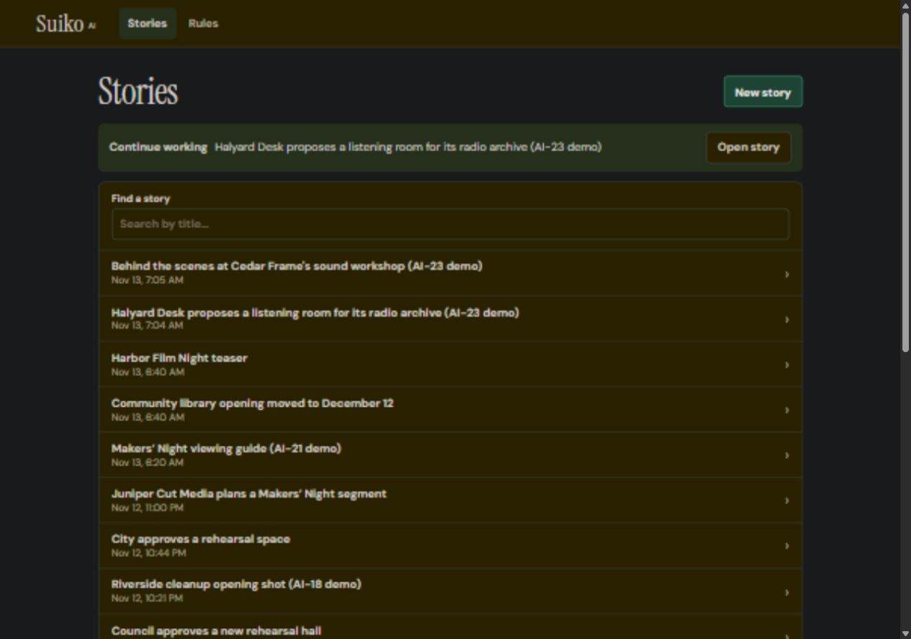
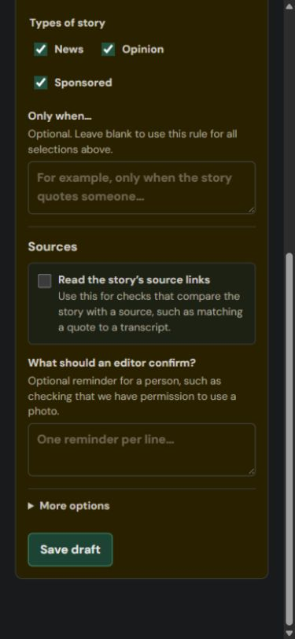

# A workspace for editors

Approved direction, 13 November 2026. Deon owns the custom screens. Teammates own the ServiceNow work in [Team tasks](../TEAM-TASKS.md).

## What the editor sees

Suiko opens the last story that person worked on in this browser. **Stories** opens a searchable list; **New story** starts another draft. A new account starts in Stories. Broken or deleted remembered links return to the list.

The Story screen has the draft on one side and the review on the other, stacked on narrow screens. Save version freezes the text. Review this version checks that saved copy. Editing does not silently run AI or replace an older result.

The review leads with **Overview** and **Needs attention**, followed by claim/source pairs, available changes and **Publishing details**. Sources, earlier versions and original rule wording remain available for inspection. A partial result explains which part needs another look. The rejected quote and saved passage can be compared directly.

**Rules** shows In use, Drafts and Off lists. Add a rule opens visible choices for writing a check, using company policy or starting from a template. Starter suggestions and help text are not disguised as existing rules.

**Legal review** shows assigned tasks and the exact copy sent for clearance. **Archive** contains hidden stories/rules with permitted restore/delete actions. Those screens need the teammate APIs before they become available in everyday navigation.

## Plain language

| Old wording | What the editor reads | Meaning |
| --- | --- | --- |
| Additional conditions | Only when… | A further restriction on when a rule runs |
| Needs source material | Read the story’s source links | Use supplied public pages to compare claims or quotes |
| What the editor may need to confirm | What should an editor confirm? | A reminder for a person, such as obtaining permission |
| Metadata suggestions | Publishing details | Section, tags and description |
| Decision 1 confidence check | Get a second check on sources | Optional second opinion on claims with source passages |
| Literal edits | Exact text edits | Words added, removed or changed |

“Only when” is a condition. A human reminder is an action the AI cannot complete for the editor. Reading source links is a separate capability. They should not be combined into one vague field.

Dates use the reader's browser timezone and a 12-hour clock, such as **Nov 13, 9:48 AM**. No seconds or UTC labels in ordinary cards. Original UTC times remain in saved evidence. Model names, raw responses and diagnostics are under closed **Technical details**.

Useful uncertainty stays visible. “Needs confirmation,” source-reading failures and disagreements between checks are editorial information. Technical provider names and validation codes are not everyday instructions.

## Draft safety and feedback

- Moving between the workspace sections preserves the current story draft. Replacing it with another story/new draft asks before discarding changes.
- Rule and policy drafts stay mounted during workspace navigation. Leaving a dirty rule form asks first. Closing/reloading with unsaved work triggers the browser warning.
- A successful save or review remains visible if its subsequent history reload fails. The message distinguishes saved work from a failed refresh.
- A toast confirms a completed action. An actionable error stays beside the relevant form. An unavailable action is never presented as successfully completed.
- Archive confirmations name the item. Permanent deletion requires an explicit confirmation and server permission; there is no bulk cleanup button.

## Boundaries and acceptance

The new frontend calls the existing live draft/review/rule/policy APIs. Archive, all-story search, human decisions and legal tasks are **contracts awaiting teammate implementation**. Capability flags keep unfinished actions out of normal navigation. Local component tests use simulated API responses to exercise these future screens; that does not prove the APIs exist on the PDI.

All **16 component checks passed** locally. They cover resuming a story, local timestamps, unsaved draft protection, successful saves/reviews with failed refreshes, partial/failed replies, policy draft retention, stale search pagination, archive permissions and legal-only access. Review follow-ups also cover Back to an unsaved new story, late refreshes after switching stories, old sign-off labels after a new save, legal-to-editor refresh, second-check disagreements and dialog focus restoration. The existing **99 AI checks also passed** after the redesign. These checks do not replace real-browser checks for layout, keyboard focus, dialog behavior and the complete installed workflow.

## Installed screen checks

[PR #19](https://github.com/DeonHolo/suiko-ai/pull/19) merged as `c227d0d`. The reviewed build was installed on 13 November 2026. Its GitHub validation and CodeRabbit checks passed. Installation readback compared fingerprints of the saved demo's revisions, review requests/results and metadata choices: all were preserved. The provider configuration remained available.

The in-app browser connection returned. The checks below were performed on the installed app as **System Administrator**. They establish these screen behaviors; they do not replace ordinary-account or unfinished platform acceptance.

| Check | Observed result |
| --- | --- |
| Entry point | Opening the app without a story ID resumed the last Halyard Desk story |
| Stories search | Searching River cleanup showed the matching saved story using the current recent-story list |
| Unsaved new story | Typed text survived Stories → browser Back without saving a version |
| Replacing a draft | Opening another story asked before discarding; Escape kept the draft and returned focus to the story link |
| Rule form | Conditions, source reading and human reminders had separate labels; the source checkbox toggled beside its text |
| Company-policy draft | Unsaved title/text survived leaving and reopening setup; temporary test text was discarded afterwards |
| Screen sizes | Story used two columns at 1280px. Rule form and claim/source cards fitted a 390px viewport with a 375px page width and no horizontal overflow |
| Technical details | Model names were absent from the ordinary review; opening Technical details revealed the saved model and fallback note |
| Times | Version, review and source times used local AM/PM and minutes without seconds |
| Earlier evidence | The first Halyard review retained the editor's original description and its 11 a.m. source passage |
| Optional second opinion | The saved Makers’ Night review showed the main Potential conflict result beside Needs confirmation at 97%, with a visible disagreement explanation |

No new Gemini call, story version, rule approval or permanent data deletion was needed. Temporary text was cleared, the viewport override was reset and the saved Halyard story was left open. No browser console errors were captured in the final check.

Remaining acceptance: regular Editor/Rules Editor screens; assigned/unassigned legal access; real archive actions and retention/deletion guards; the full human/legal workflow; and a teammate-led ordinary-account rehearsal. The new platform capabilities remain off. Component simulations are not evidence that those APIs exist.

Full browser snapshots, installation fingerprints and screenshots are retained locally under `ai-review/output/newsroom-ui-2026-11-13/`. The examples below show the actual browser's dark appearance.

The existing brand is retained: readable sans-serif body text, serif page headings, restrained green accents and clear spacing. The priority is scanning and completing an editorial task. The earlier generic design search suggested unrelated landing-page treatments; those were not adopted.

The applied local guidance covers form clarity, accessibility and brief action feedback. Useful references are [Vercel's interface guidelines](https://vercel.com/design/guidelines), [Sonner's API guidance](https://github.com/emilkowalski/skills/blob/main/skills/ask-sonner/API.md), and [Impeccable's critique/clarify/audit tools](https://github.com/pbakaus/impeccable). No new skill bundle or repository automation was installed from those references.
