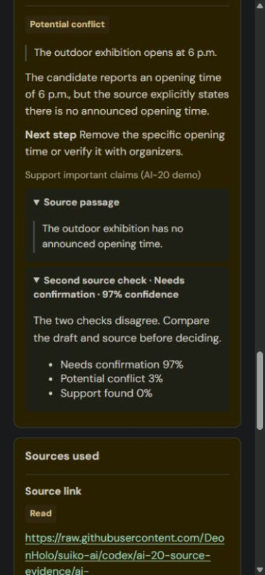

# What the AI work delivered

AI-16–AI-23 are merged. The AI feature saves a draft, reviews it against approved company checks, shows its reasons and preserves evidence. The required human/legal workflow remains team work. [Acceptance evidence](23-acceptance-results.md) · [Team tasks](../TEAM-TASKS.md).

## The eight completed tickets

| Ticket | Result |
| --- | --- |
| AI-16 | Usable parts survive a partly broken AI reply; missing checks are explained |
| AI-17 | Format, story type, links and notes saved with each version |
| AI-18 | Editable starter/manual rules with approval and applicability |
| AI-19 | Company-policy text retained beside original-wording or refined proposals |
| AI-20 | Supplied public pages/text PDFs actually retrieved; passages and failures retained |
| AI-21 | Individual claim/source comparisons and optional Decision 1 second opinion |
| AI-22 | Revision summaries checked against actual saved text edits |
| AI-23 | First article, revision, unrelated script, broken link, rule changes and saved history evaluated in ServiceNow |

Jina Reader and jsdiff were reused. LangExtract was not needed and was not added. No independent web search is performed: the editor supplies up to five public links.

## Did Decision 1 make it in?

**Yes. It is an optional second source check, not the main writer.** Flash-Lite writes the overview, changes, suggested publishing details and rule results. Decision 1 gives probabilities for eligible claim/source comparisons that already have retrieved passages. The new checkbox is **Get a second check on sources**.

The first nine-case comparison matched **8 of 9 expected labels for each model**. Both initially confused “the opening time has not been announced” with a contradiction. Refining the Decision 1 question changed its answer to **Needs confirmation, 97% confidence**; Flash-Lite still called a conflict. The screen showed both answers and the source so the editor could decide.

Decision 1's initial nine-case batch took 1.07 seconds and 2,218 input tokens; an installed three-question rerun took 237 ms and 1,081 input tokens. These were small observed trials, not a controlled performance benchmark or proof that one model is generally better.

The integration checks up to 12 eligible claims with a bounded request. If it is unavailable or only covers some claims, the main review remains and the gap is stated. There is no automatic confidence cutoff and no claim of guaranteed truth. [Trial and live evidence](21-claim-and-source-review.md).

## What worked and what was wrong?

The evaluated article correctly identified an overconfident headline, a time mismatch, supported seating and an unconfirmed fee. The revision produced three useful changes. A broken source did not erase the usable results or the editor's chosen description. Older reviews reopened with their original source and rule versions.

The unrelated script correctly asked for outside-photo permission, but Flash-Lite labelled the missing permission a Potential conflict when the approved instruction wanted Needs confirmation. It also exposed a rule identifier in its generated overview. These remain recorded model-quality limits; the UI redesign does not pretend the model's judgment became infallible.

The **99 AI checks and 16 screen checks passed**, including on GitHub. The redesign was merged in [PR #19](https://github.com/DeonHolo/suiko-ai/pull/19), installed and inspected in the in-app browser. Saved evidence and publishing choices survived installation. The new screen inspection used admin; ordinary-account and full human-workflow acceptance remain separate. [Exact checks and screenshots](24-newsroom-workspace.md#installed-screen-checks).

## Who does what next?

Deon owns the custom Story, Stories, Rules, Legal Review and Archive screens, AI behavior, integration and evaluation. The current UI change simplifies everyday language, times, rule setup and navigation.

Najarro owns story-list data and editor decisions (#1/#4). MGP owns archive/restore and history/access (#2/#6). Russjie owns legal records and routing (#3/#5). Existing claim comments remain; #7 is the whole-app rehearsal.

The new Archive/Legal/decision controls depend on those APIs. They stay unavailable in normal navigation until the server declares them ready. Component tests using simulated responses prove frontend behavior, not completed teammate work. All seven issue bodies now contain the updated ServiceNow steps and AI prompts; their existing claims were preserved.

[Deon's next steps](27-owner-next-steps.md) lists work that can continue independently and the exact integration/test handoff after each of the seven teammate tickets.

## Try the saved evidence

1. [Open the saved Halyard Desk demo](https://dev309702.service-now.com/x_2236136_suiko_ai_review.do?story=89688f4583e4db106fffc629feaad327), or find it in Stories.
2. Choose its first and revised reviews in Review history. The earlier choice remains read-only while you inspect that saved result.
3. Compare the claim and source passages, inspect the earlier publishing choice and open Rules used.
4. To try another review, save a fictional draft with format/type, supplied public links and optional notes. Approved source-reading rules determine whether those links are read.
5. If applicable source rules and links are present, choose Get a second check on sources before reviewing. Open its result to inspect confidence or disagreement.

Editors and legal reviewers retain publishing authority. Suiko helps them inspect the material and decide; publication remains in the team's existing publishing tools.

The saved disagreement was reopened in the redesigned UI. No new model call was made for this screenshot.

