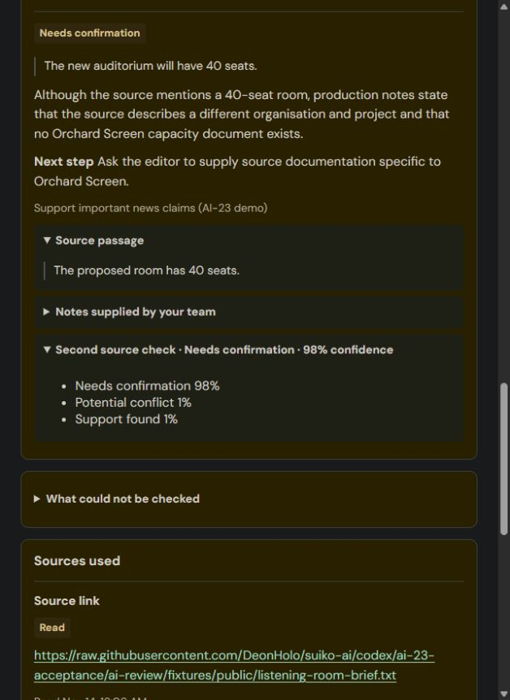

# Owner validation and remaining acceptance

> Update, 14 November 2026: Decision 1 is removed from new editor reviews; the results below remain historical evidence. See [the owner decision](30-decision-1-retirement.md).

These checks use fictional stories in the team development instance. Expectations were saved before model calls in `ai-review/output/owner-validation-2026-11-13/expected-results.md`. Raw replies, failures, checked results, browser states and screenshots remain in the ignored output folder. The repeatable [media pack](../ai-review/fixtures/owner-media-pack.json) uses isolated fixture rules; it does not edit live approvals.

## Reviewed and installed history fix

[PR #22](https://github.com/DeonHolo/suiko-ai/pull/22) merged as `b89af61`. Its new refresh regression failed before the fix. All 21 screen checks, 99 AI checks and the frozen-key SDK build passed. CodeRabbit marked the functional finding addressed; separate requirements and standards reviews found no other issue.

The installation preflight found no app-file changes in Studio after the prior install at 14:13 UTC. Before/after fingerprints preserved all 18 existing stories and their captured revisions, reviews, source snapshots, publishing choices, rule approvals and policy records. Provider configuration remained available. The SDK build completed with its existing generated-dependency scanner diagnostics.

The actual in-app browser worked. Using an ordinary Editor, view A held an unreviewed Version 2 and unsaved text; view B completed its review. Refresh in A selected the current result, removed the unreviewed placeholder and preserved the text. Selecting the Version 1 review and refreshing preserved that selection and its saved description. These were two views of the same ordinary account, rather than two independently authenticated people.

## Actual source and Decision 1 results

Story `8d67aa5583605f106fffc629feaad392` has a first draft and corrected revision. The main first review fell back from Gemini 3.5 Flash-Lite after HTTP 503 to 3.1 Flash-Lite; the revised review completed on 3.5. Both read the public noon brief and text PDF, and recorded the missing URL as unavailable. No claim cited the unrelated PDF. Missing-link status did not erase the usable overview or publishing controls. The table below describes those preserved pre-PR #23 runs; the final installed rerun is recorded at the end of this document.

| Saved copy | Main review | Decision 1 |
| --- | --- | --- |
| Version 1: 11 a.m. | Conflicts with the brief's noon | Conflict, 98.12% |
| Version 1: 40 seats | Support found | Support, 99.32% |
| Version 1: three-dollar entry | Needs confirmation; price is pending | Needs confirmation, 96.43% |
| Version 2: noon | Support found | Support, 99.36% |
| Version 2: 40 seats | Support found | Support, 99.27% |
| Version 2: admission pending | Support found | Support, 68.48% |

Decision 1 completed all three eligible comparisons in each installed review: 295 ms/1,193 input tokens and 241 ms/1,186 input tokens respectively. These are observed calls, not controlled performance benchmarks. Confidence is not proof of truth. The revision summary identified the actual title, time and admission edits. The first review retained the Editor's description.

The earlier Harbor teaser remains a different case: its IANA link was skipped because no applicable approved rule requested sources, and none of its original four reviews requested Decision 1. The saved Makers’ Night disagreement remains historical evidence; it is not a new model result from this validation.

## Permission improvement and observed failures

The baseline controlled Cedar Frame script again asked for the outside photo's permission but returned Potential conflict under both rights rules. After the instruction refinement, the same frozen input returned Needs confirmation under both rules on separate 3.5 and 3.1 runs. Staff-only material produced no rights concern, explicitly denied footage still produced a conflict under the broad rule, and missing/visible paid disclosures remained distinct on the completed 3.1 comparison. No approved live rule was rewritten.

Gemini 3.5 returned several HTTP 503 failures, retained alongside successes. The comparisons on 3.1 were run explicitly and recorded separately. Some replies still supplied invalid concern references or tried to support public metadata with internal notes; the validator removed those suggestions and exposed the gaps. These are unresolved model-quality limits.

The original pilot's strict staff-only status expected Not applicable; No issue found is also an acceptable no-warning result. Its expectation for the narrow missing-record rule on an expressly denied clip was too prescriptive. Both original expectations and mismatches remain saved; the reusable rubric explains the correction.

The held-out licensed-audio caption produced no missing-permission warning, and a different-format outside-photo caption requested confirmation. In the broader controlled source run, Flash-Lite omitted the 40-seat check from the first article and omitted admission-pending from the revision. The installed reviews did cover those facts. The omissions remain recorded, and there is no claim of complete model coverage.

## Decision 1 context regression

A held-out Orchard Screen auditorium case used a Halyard brief about a different project. Flash-Lite correctly returned insufficient support. The optional check, which received only the isolated seats sentence and source, returned Support at 51.57%. Its request lacked the story context identifying Orchard Screen.

A new regression failed on that missing context. The second opinion now receives the current public title/body/caption once alongside its claim cases. Internal notes and the baseline are excluded; the current story identifies the claim's subject and is not independent source evidence. The question version is `source-support-3`.

Replaying the identical saved claim/source material with that context changed Decision 1 to Needs confirmation at 97.72%. The conflicting-time, unknown-price and supported-time/seat comparison labels remained appropriate. All 100 AI checks passed at that stage. This was a real Decision 1 API call from the local evaluation; the separate installed verification is recorded below.

## Repeating the controlled pack

From the repository root, prepare the existing generated prompt and validators, then run the live evaluation:

```sh
node servicenow-app/scripts/prepare-review.mjs
node servicenow-app/scripts/evaluate-media.mjs gemini-3.1-flash-lite --decision
```

The runner reads the existing ignored local Gemini configuration. It saves full expectations and immutable inputs before calling either model, then saves raw/checked replies, HTTP failures, exact evidence issues, expected/actual rule and claim outcomes, and optional Decision 1 requests/results in a new ignored output folder. It does not perform new source retrieval or use live company approvals. `--dry-run` saves the plan without model calls; `--cases=article-sources,article-revision` selects a smaller pack. A nonzero result preserves failures or misses for inspection instead of treating them as a pass.

## Boundaries still to verify

Ordinary Editor save/review/source inspection and publishing-choice actions passed. The installed server regression suite passed its non-admin permission checks and restored its runner settings. A direct policy API URL opened in the browser returned unauthenticated; that result does not establish a role-specific denial. The server suite supplies the separate direct-action authorization evidence.

Keyboard activation and Escape returned focus to the sample-dialog opener. Labels, loading, partial results and historical read-only publishing controls were inspected. A requested 390px viewport was clamped by the in-app browser to a wider rendered view. A separate local 390px frame then rendered the built frontend with a 375px page and 335px long-title area, without horizontal overflow. This confirms that local narrow layout; an exact-width live ServiceNow phone walkthrough and a full assistive-technology audit remain pending.

Archive, Legal and human decisions remain platform-team dependencies. Component simulations verify prepared frontend behavior; they do not complete a teammate ticket or prove live assignment, deletion, retention or clearance guards. Teammate PRs remain for Deon's approval. Final installed follow-up and account cleanup are recorded below.

## Further ordinary-account and simulated checks

The ordinary Rules Editor saved and approved a new rule named Owner validation only, scoped by an explicit fictional test-title condition, then turned it off. The screen recorded Suiko Temporary Rules Editor as approver. Existing company rules were not edited. A 6,120-character unsaved policy draft and long policy title survived Stories → Rules navigation; the temporary text was cleared without saving a policy or requesting a model proposal.

In the in-app browser, a local page explicitly labelled LOCAL SIMULATION supplied example contract responses to the built frontend. Routing a saved version to legal, viewing the submitted copy and reason, clearing it, returning to the editor and signing off all worked. The simulated AI failure remained visible without blocking those human controls. The requests included revision and modification guards. Archive hid permanent delete for retained evidence, kept the simulated stale-delete error in its confirmation, restored both example items and displayed the empty state. These results establish screen behavior only; no ServiceNow legal, archive or sign-off action was performed.

CodeRabbit's further valid findings concerned non-JSON provider failures and invalid evidence being counted as a passing evaluation. Focused checks reproduced both before their fixes. The runner now records HTTP status and raw response text before decoding, and invalid checker outcomes fail its verdict. Optional-check coverage, wrong labels and omitted expected claims have separate regressions. All 105 AI checks and 21 screen checks pass.

## Final installed results — 14 November 2026, Singapore

[PR #23](https://github.com/DeonHolo/suiko-ai/pull/23) merged as `8a13505` after CI and CodeRabbit passed, valid findings were fixed, and the discussions were resolved. The reviewed build was installed from `main`. A fresh preflight again found no newer shared Studio app files. Before/after fingerprints preserved all 20 current stories, saved revisions/reviews/sources, publishing choices, rule approvals and policy records. The provider remained configured. The installed server regression suite passed both tests again, including six direct rule/policy handlers returning 403 for the non-admin Editor, and restored its test-runner settings.

The following new reviews were run through the actual in-app browser as **Suiko Temporary Editor**, with only the Editor role. Each stored review references the selected saved revision and prompt `0.5-workbench-4`. No saved draft was rewritten to obtain these outcomes.

| Installed case | Expected | Actual |
| --- | --- | --- |
| Cedar Frame outside photo | Ask for the named photo's permission, Needs confirmation | Both applicable rights rules returned Needs confirmation with specific follow-ups. No source rule applied and no source/Decision 1 call was requested. The overview was withheld because it cited internal notes as overview evidence. |
| Orchard Screen's 40 seats, linked to the Halyard brief | The other project's brief cannot establish this project's capacity | The brief was read. Main review and Decision 1 both returned Needs confirmation. Decision 1: **98.24%**, question `source-support-3`, 235 ms, 571 input tokens. |
| Halyard Version 2: noon | Supported by the brief | Main review supported it; Decision 1 Support **98.01%**. |
| Halyard Version 2: 40 seats | Supported by the brief | Main review supported it; Decision 1 Support **98.97%**. |
| Halyard Version 2: admission pending | Supported by the matching source wording | Main review supported it; Decision 1 instead returned Needs confirmation **50.92%**, with Support at **48.45%**. The screen showed the disagreement. This is an actual remaining model miss, not a corrected label. |

The final Halyard second check completed all three eligible claims in 392 ms with 1,493 input tokens. Its brief and text PDF were read again; the missing URL remained unavailable, and no claim used the unrelated PDF. The new overview and all three actual text-change summaries remained available. These observed calls do not establish general accuracy or comparative performance.

The Orchard review also recorded diagnostics for invalid concern references, an unmatched duplicate source finding and an unverifiable overview reference. The invalid references were removed; the usable claim, second opinion and unmatched finding remained inspectable, and its overview was withheld. The saved technical issues and plain-language gaps were not counted as a clean model-quality pass.

Selecting the earlier Cedar review and refreshing retained its original wrong label and internal rule identifier. Selecting the Halyard Version 1 review and refreshing retained the Editor's original description, with publishing fields read-only for that earlier version. API fingerprints separately confirmed that every pre-existing review in the three acceptance stories and all their saved revisions remained unchanged. The repeated-review component fixture now gives its prior-version run an earlier timestamp too, so its entire newest-first order is explicit.

Both password-free temporary accounts were **disabled and locked** after testing. The temporary rule remains off; unsaved test text was cleared; the original administrator session and default viewport were restored. The verified Orchard source result was left open in the in-app browser. No teammate PR was merged and no unfinished workflow capability was enabled.



Raw expected/actual inputs, failed attempts, original and final server-suite results, installation fingerprints, browser states and screenshots are saved locally under `ai-review/output/owner-validation-2026-11-13/`, with additional controlled calls in timestamped `ai-review/output/media-*/` folders. The folder name marks the start of the session; final installed checks crossed into 14 November Singapore time. The raw files contain no provider credentials.

## Next demonstration and tests

For the demo, open the saved Owner validation Halyard story. Compare Version 1's time/price concerns with Version 2's actual edits; reopen the earlier publishing choice. Show Sources used to distinguish read, unrelated and failed links. Show the optional second check and the preserved admission-pending disagreement, then the Orchard example explaining why a matching number from another project is insufficient. Keep human sign-off marked pending in the live-app segment; the completed sign-off preview was a local simulation.

The next real integration work remains the teammate APIs: full story search/status/pagination, archive/restore and retention/deletion guards, assigned/unassigned legal access, frozen legal submissions, fresh clearance after revision, editor decisions, human history and the independent whole-app rehearsal. Complete the role-specific HTTP authorization matrix and assistive-technology audit too. The existing server-handler denial checks and screen walkthroughs do not prove every transport/role boundary or live workflow action.
