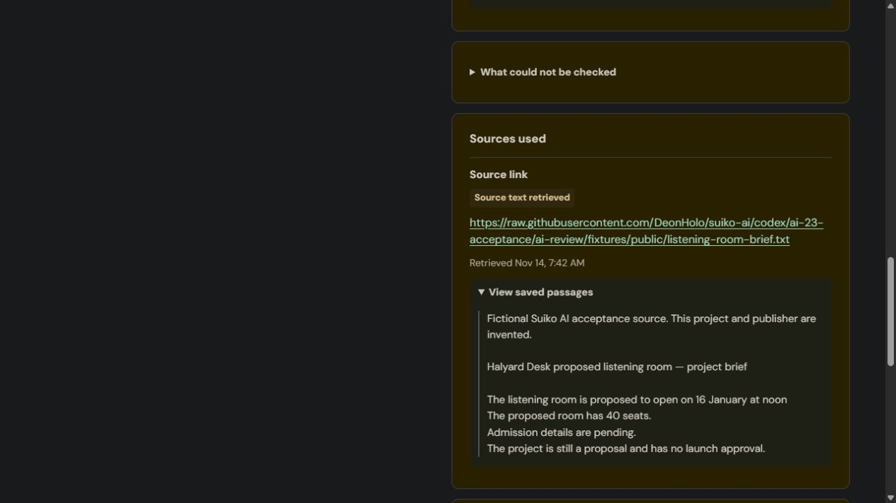

# Decision 1: retained for experiments, removed from editor reviews

Owner decision: 14 November 2026.

The editor runs one AI review. Remove the optional second-source-check checkbox and stop Decision 1 calls from the live review endpoint, including requests from older clients that still send `decision_check: true`. New saved requests explicitly record `decision_check_requested: false`.

The main review still retrieves source text when an applicable approved rule requires it, compares claims against saved passages, and reports Support found, Potential conflict or Needs confirmation. Editors can inspect those passages and make their own decision.

The extra model added competing answers, percentages and another control without enough demonstrated benefit. In the latest installed Halyard test, the main review supported the source's admission-pending wording while Decision 1 returned Needs confirmation (50.92%). Other trials helped, but the small samples do not establish better accuracy. See [the original results](29-owner-validation.md); those records remain historical evidence.

Keep Decision 1's backend helper, question builder, fixtures, evaluation runner and tests for explicitly requested future experiments. There is no new public experiment endpoint or automatic experiment call. Existing saved second-check results remain readable in review history, including disagreements. No source snapshots, reviews, approvals or publishing choices are deleted.

The source status **Read** becomes **Source text retrieved**, with **Retrieved** timestamps and **View saved passages**. Partial, unavailable and not-retrieved statuses use matching retrieval wording. This reports retrieval, not proof of accuracy or source trustworthiness.

## Verification expectations recorded before execution

- With matching approved source rules and links, the story offers Review this version with no second-check checkbox. Its request has no `decision_check` field.
- Even a legacy request with `decision_check: true` produces only the main review and records the second check as not requested.
- Source retrieval and main claim comparisons continue. Retrieved text uses the new wording and saved passages open.
- A saved historical second-check result and disagreement remain visible.
- Review/UI tests and the SDK build pass; installation preserves existing evidence and newer Studio work.

No Gemini prompt or model-quality behavior is being tuned by this change. Any new live review is a wiring check against these expectations, not evidence of improved model accuracy.

## Installed results — 14 November 2026

[PR #25](https://github.com/DeonHolo/suiko-ai/pull/25) merged as `4ee7289` and was installed after a preflight found zero newer scoped Studio files. Before/after fingerprints preserved all 20 stories, existing revisions/reviews/source snapshots, rule approvals, policies and publishing choices. The final additive review check confirmed the original records remained unchanged too.

The 105 review tests, 23 UI tests and frozen-key SDK build passed. The build still reports the existing generated dependency scanner diagnostics (3 errors, 12 warnings) before completing successfully. Requirements review found one outdated README sentence, which was corrected; standards review found none. CodeRabbit's valid installed-evidence request is satisfied by the checks below. No teammate PR was merged.

The installed server suite passed both tests with zero failures: result `6b5a946983ac5f106fffc629feaad3c3`. Its dedicated non-admin Rules Editor ran the claim regression with `decision_check: true`: the second provider hook was never called, the saved request recorded false, source retrieval and individual checks remained, and reopening retained that evidence. The suite also ran the existing Editor permission checks. ATF fixture data rolled back and runner settings were restored.

In the in-app browser, signed in as admin, Orchard showed no second-check checkbox. The pre-existing review `7a527e1d83a05f106fffc629feaad303` reopened with its complete historical Decision 1 result: Needs confirmation, 98.24%, and the original source passage. The new Source text retrieved / Retrieved / View saved passages wording appeared, and saved passages expanded.

Then Review this version created `5eaad4a983ac5f106fffc629feaad3f1` using `gemini-3.5-flash-lite`. It completed with `decision_check_requested: false` and no `decision_check` result. The actual linked brief was retrieved as one passage. This meets the retirement and retrieval expectations.

Model judgment remains imperfect: this fresh run classified the other project's 40-seat source as **Potential conflict**, while the earlier acceptance rubric and saved run called for **Needs confirmation**. It identified the source mismatch and asked for the correct document, but a source about another project does not itself disprove Orchard's capacity. It also retained `INVALID_CONCERN_PASSAGE` and `UNMATCHED_SOURCE_FINDING` diagnostics; its overview was available. No prompt was changed or label retuned to hide this variation. This is a successful wiring check, not a clean model-quality pass.

Raw expectations, actual JSON, complete saved state, browser snapshots/screenshots, preservation fingerprints, installation evidence and server-suite results are in the ignored local folder `ai-review/output/source-review-2026-11-14/`. Expectations were saved before the live Gemini call. The PR records the same installed result for review.

This focused check used admin in the browser and ordinary roles in the server suite. A fresh ordinary-account browser walkthrough of this revision, the complete transport/role matrix, assistive-technology audit and real teammate workflow integrations remain separate work. Earlier UI/account results and model failures remain in [the owner validation report](29-owner-validation.md).
